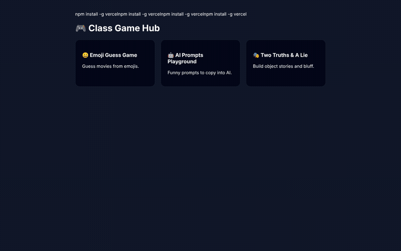
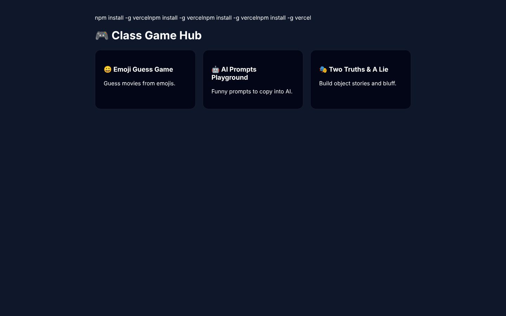
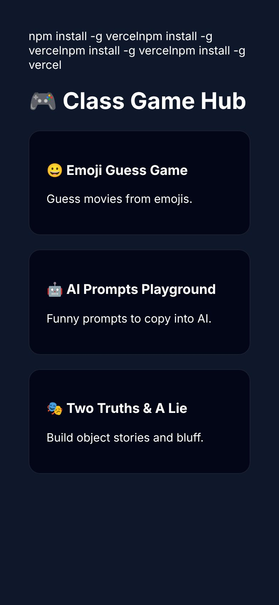

# EQC Class Games

> A hub of quick classroom games: Emoji Guess, AI Prompts Playground and Two Truths & A Lie. 🚧 Flagged for an update.

**Live demo:** [eqc-class-games.vercel.app](https://eqc-class-games.vercel.app)

  

## Features

- **Emoji Guess Game**: guess movies from emojis
- **AI Prompts Playground**: funny prompts to copy into an AI chat
- **Two Truths & A Lie**: build object stories and bluff
- Scoreboard page for keeping track of teams

## Tech stack

- Plain HTML, CSS and vanilla JavaScript
- Hosted on Vercel

## Run it locally

```bash
git clone https://github.com/thedalycreative/eqc-class-games.git
cd eqc-class-games
npx serve .
```

## Deployment (Vercel)

Static site, repo root is the output. The Vercel project **eqc-class-games** deploys `main` to **https://eqc-class-games.vercel.app**. (Previously deployed by CLI as `nugget-warriors-party`; source recovered from that deployment, with a stray line of text removed from the top of the home page.)

## Screenshots



<p align="center">
  
  
</p>

_Captured from the live site (https://eqc-class-games.vercel.app). Regenerate with any headless browser; files live in `docs/screenshots/`._

> **To do:** flagged for an update.

---

Built by [The Daly Creative](https://www.thedalycreative.com) · Perth, WA
